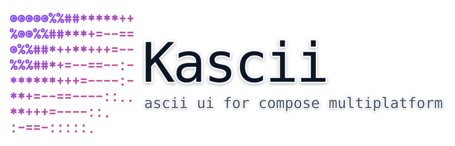
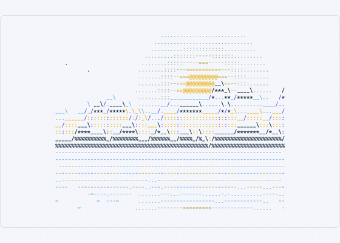
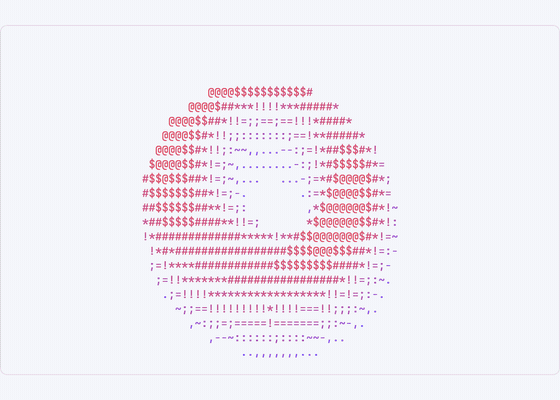
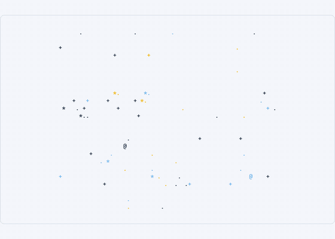
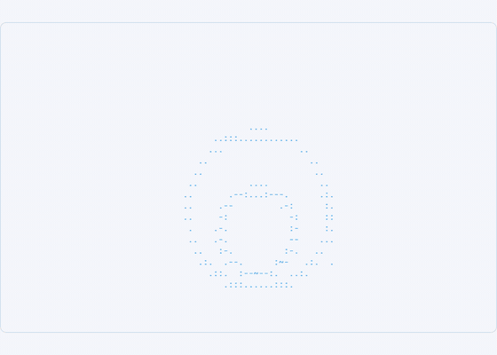
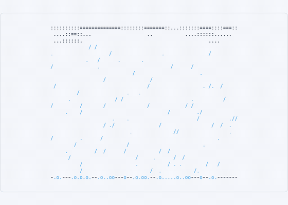
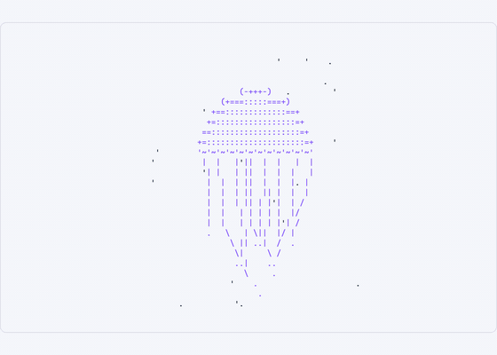
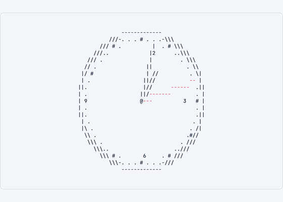
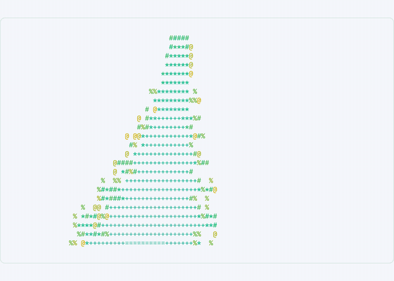
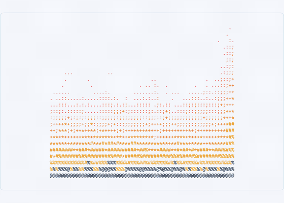

<p align="center">
  
</p>

<p align="center">
  <a href="https://central.sonatype.com/artifact/io.github.jantursky/kascii-compose"></a>
  <a href="https://github.com/jantursky/kascii/actions/workflows/ci.yml"></a>
  <a href="https://codecov.io/gh/jantursky/kascii"></a>
  
  <a href="LICENSE"></a>
</p>

<p align="center">
  <a href="https://kascii-docs.vercel.app">Docs</a> ·
  <a href="https://kascii-demo.vercel.app">Demo</a> ·
  <a href="https://central.sonatype.com/artifact/io.github.jantursky/kascii-compose">Maven Central</a> ·
  <a href="CHANGELOG.md">Changelog</a>
</p>

Kascii draws text-mode art in Compose Multiplatform. A tone, a number from 0 to 1, becomes a glyph: a dot, a hash, a block, a Braille pattern. A small engine does the mapping, and anything in Compose can use it: a background, a photo, a button, a chart, a line of big text or a whole animated scene.

It runs on Android, iOS, JVM desktop and wasmJs from one `commonMain` source set. The engine has no UI dependency and the Compose layer has no Material dependency.

- **Engine.** Fields, 14 built-in charsets (classic ramps, blocks, quadrants, Braille at 2 x 4 dots per cell, CP437, PETSCII, katakana, an edge-aware one), six color modes, themes, a frame clock and export to text, ANSI and SVG.
- **Compose.** `AsciiCanvas`, `AsciiImage`, `Modifier.ascii` for any element, and three renderers: a GPU shader, a cached glyph atlas, and real selectable text.
- **Components.** Buttons, forms, tabs, tables, a terminal, charts, a Braille pie chart, spinners and eleven text effects, with real semantics and keyboard support.
- **Gallery.** 26 animated pieces to start with, each a composable with a seed, deterministic and tested as text.
- **Calm by default.** Everything pauses offscreen and in the background and holds a still frame under reduced motion.

<table>
  <tr>
    <td align="center"><picture><source media="(prefers-color-scheme: dark)" srcset=".github/assets/scenes-dark.gif"></picture><br><sub>scenes</sub></td>
    <td align="center"><picture><source media="(prefers-color-scheme: dark)" srcset=".github/assets/shapes-dark.gif"></picture><br><sub>shapes</sub></td>
    <td align="center"><picture><source media="(prefers-color-scheme: dark)" srcset=".github/assets/space-dark.gif"></picture><br><sub>space</sub></td>
  </tr>
  <tr>
    <td align="center"><picture><source media="(prefers-color-scheme: dark)" srcset=".github/assets/physics-dark.gif"></picture><br><sub>physics</sub></td>
    <td align="center"><picture><source media="(prefers-color-scheme: dark)" srcset=".github/assets/nature-dark.gif"></picture><br><sub>nature</sub></td>
    <td align="center"><picture><source media="(prefers-color-scheme: dark)" srcset=".github/assets/creatures-dark.gif"></picture><br><sub>creatures</sub></td>
  </tr>
  <tr>
    <td align="center"><picture><source media="(prefers-color-scheme: dark)" srcset=".github/assets/objects-dark.gif"></picture><br><sub>objects</sub></td>
    <td align="center"><picture><source media="(prefers-color-scheme: dark)" srcset=".github/assets/generative-dark.gif"></picture><br><sub>generative</sub></td>
    <td align="center"><picture><source media="(prefers-color-scheme: dark)" srcset=".github/assets/effects-dark.gif"></picture><br><sub>effects</sub></td>
  </tr>
</table>

## Install

The modules are published to Maven Central under `io.github.jantursky`.

```kotlin
commonMain.dependencies {
    implementation("io.github.jantursky:kascii-compose:1.0.0")    // AsciiCanvas, Modifier.ascii, renderers
    implementation("io.github.jantursky:kascii-components:1.0.0") // interface, data and text-effect components
    implementation("io.github.jantursky:kascii-gallery:1.0.0")    // animated pieces
}
```

`kascii-core` (fields, charsets, grid, export, the piece kit) comes in through the others. Use it alone when you want the engine without any UI.

## Usage

A procedural background:

```kotlin
AsciiCanvas(
    field = Fields.plasma(),
    modifier = Modifier.fillMaxSize(),
    charset = Charsets.Blocks,
    cell = 8.dp,
)
```

Any element as ASCII:

```kotlin
Box(Modifier.ascii(charset = Charsets.Blocks, cell = 8.dp)) {
    Image(painter = painterResource(Res.drawable.photo), contentDescription = null)
}
```

A piece from the gallery, and a button:

```kotlin
Donut(Modifier.size(320.dp))

AsciiButton(label = "OK", onClick = { /* ... */ })
```

Your own piece with the kit:

```kotlin
val orbit = asciiPiece(name = "orbit", category = "space", cols = 64, rows = 24, still = 2f, loop = 10f) { t, grid ->
    grid.disc(32f, 12f, 4f, '@')
    grid.disc(32f + 18f * cos(t), 12f + 6f * sin(t), 1.5f, 'o')
}

AsciiPieceView(orbit, Modifier.fillMaxWidth().aspectRatio(64f / 24f))
```

More in the [docs](https://kascii-docs.vercel.app) and the [live demo](https://kascii-demo.vercel.app), where every piece comes with its source and controls for charset, speed, seed, renderer, reduced motion and copy as text, ANSI, SVG or PNG.

## How it works

1. A **field** (`kascii-core/.../Field.kt`) returns a tone for a position and a moment. `Fields` has plasma, noise, waves, ripples, gradients and more, and `Field { x, y, t, aspect -> ... }` is all you need for your own.
2. The **rasterizer** (`Rasterizer.kt`) samples the field at one point per cell, or eight for Braille, and maps the tones through a **charset** (`Charset.kt`). It is pure, so the same inputs give the same grid on every platform and you can test it with plain text.
3. A **color mode** (`ColorMode.kt`) colors each glyph from the theme, a gradient, a duotone or a per-cell source. A `KasciiTheme` carries the ink, paper and palette, and can be built from Material 3 colors.
4. A **renderer** (`kascii-compose/.../internal`) draws the `Grid`. The CPU path builds a glyph atlas from the bundled font once and draws cells from it. The GPU path hands the atlas to a runtime shader (AGSL on Android 13 and newer, Skia `RuntimeEffect` elsewhere) and falls back to the CPU path if anything fails. The text path produces selectable `AnnotatedString` text.
5. A **clock** drives animation from the frame clock and reads time only while drawing, so frames never recompose. It stops when the element is offscreen or the app is in the background, and holds the still frame when motion is reduced.
6. **Components** (`kascii-components`) are pure functions that build a `Grid`, tested as golden text, wrapped in a thin composable that adds interaction, semantics and focus. **Pieces** (`kascii-gallery`) are pure functions of time and a seed, tested the same way.

## Prior art

Kascii stands on two projects that proved the idea on the web. [asciicn](https://asciicn.dev) is a React ASCII engine with ten charsets, color modes, a WebGL glyph shader and export. [ascii.rest](https://github.com/bas3line/ascii) is a catalogue of about 240 animated ASCII pieces with a kit for building more. Both are MIT licensed. Where a gallery piece is a port of a specific ascii.rest piece, its KDoc says so and the original license is in [`THIRD_PARTY_NOTICES`](THIRD_PARTY_NOTICES). The ascii.rest logo, company and distro groups are not ported, since they are third-party trademarks.

[Stipple](https://github.com/jantursky/stipple) is the same author's dithered-UI library for Compose Multiplatform. It turns tone into ink and paper dots where Kascii turns it into glyphs, they share an architecture, and the docs show how to [use them together](https://kascii-docs.vercel.app/guides/using-with-stipple).

A search of klibs.io, GitHub and Maven Central found no library for ASCII or text-mode effects on Compose Multiplatform. The nearest are [ShaderX](https://github.com/Debanshu777/ShaderX) (its sample app has an ASCII camera built from one dither shader), [Kasciffy](https://github.com/gmitch215/kasciffy) (image and video to ASCII without Compose rendering) and [HypnoticCanvas](https://github.com/mikepenz/HypnoticCanvas) (shader plumbing).

## Platform support

All four targets build and the common code is tested on each. What was actually run, as of 2026-11-20:

| Platform | Builds | Tests run | Run as an app | Notes |
| --- | --- | --- | --- | --- |
| JVM desktop | yes | unit, UI and screenshot tests | yes, the sample window | GPU and CPU renderers agree to one 8-bit step in tests. |
| wasmJs | yes | common tests in headless Chrome, 179 end-to-end checks of the demo in Chromium, Firefox and WebKit | yes, the demo | Uses the CPU renderer. The GPU path with image children is **unverified** in browsers. |
| Android | yes, the sample APK | common and host tests (Robolectric) | **not run** on a device or emulator | The AGSL shader path, asset font loading and reduced motion are **unverified**. |
| iOS | yes, arm64 and simulator, the sample app | common tests on the simulator | **not run** | The Skia shader path, the font and reduce-motion are **unverified**. |

Background pausing relies on the host frame clock stopping and is documented, not tested, on every platform. Per-piece frame times on a mid-range Android device and in a browser have not been measured yet.

## Not covered yet

- Camera, video and microphone sources (`AsciiCamera`, `AsciiVideo`).
- Animated export to GIF and WebM. Text, ANSI, SVG and PNG are covered.
- FIGlet fonts. Big text uses two block fonts drawn for Kascii, because the standard FIGlet fonts have no clear license.
- Most of the planned gallery: 26 pieces ship in the first release. Later phases add the rest of the ascii.rest catalogue re-implemented in Kotlin, city skylines, simulations, interactive pieces and seasonal pieces.
- Interactive expand and collapse in `AsciiTree`, tap to select in `AsciiCalendar` and image support in `AsciiAvatar`.
- Frame-time budgets per piece on devices.

## Development

```bash
./gradlew jvmTest                       # unit and UI tests on the JVM
./gradlew testAndroidHostTest           # Android host tests
./gradlew wasmJsTest iosSimulatorArm64Test
./gradlew spotlessCheck apiCheck koverVerify
./gradlew :samples:desktop:run          # the demo in a window
./gradlew :samples:web:wasmJsBrowserDistribution && bun run test:web
bun run build:docs                      # the docs site
bun run screenshots                     # re-record the README GIFs
```

See [CONTRIBUTING.md](CONTRIBUTING.md). Agent instructions for building with Kascii are in [`skills/kascii/SKILL.md`](skills/kascii/SKILL.md).

<!-- PROJECTS:START -->
## Other Projects & Products

<table align="center">
  <tr>
    <td align="center" valign="top" width="33%">
      <a href="https://github.com/jantursky/" target="_blank" rel="noopener noreferrer">
        <picture>
          <source media="(prefers-color-scheme: dark)" srcset="https://apptiary.com/projects/icons/github-dark.svg">
          
        </picture>
        <br><b>GitHub Profile</b>
      </a>
      <br><sub>Open-source repositories &amp; code</sub>
    </td>
    <td align="center" valign="top" width="33%">
      <a href="https://podcasttotranscript.com/?utm_source=kascii&amp;utm_medium=readme&amp;utm_campaign=other-projects&amp;utm_content=podcast-to-transcript" target="_blank" rel="noopener noreferrer">
        <picture>
          <source media="(prefers-color-scheme: dark)" srcset="https://apptiary.com/projects/icons/podcasttotranscript-dark.svg">
          
        </picture>
        <br><b>Podcast To Transcript</b>
      </a>
      <br><sub>Podcast transcripts, summaries &amp; chapters</sub>
    </td>
    <td align="center" valign="top" width="33%">
      <a href="https://loupekit.com/?utm_source=kascii&amp;utm_medium=readme&amp;utm_campaign=other-projects&amp;utm_content=loupekit" target="_blank" rel="noopener noreferrer">
        <picture>
          <source media="(prefers-color-scheme: dark)" srcset="https://apptiary.com/projects/icons/loupekit-light.svg">
          
        </picture>
        <br><b>LoupeKit</b>
      </a>
      <br><sub>Tech stack, design tokens, AI code checker</sub>
    </td>
  </tr>
  <tr>
    <td align="center" valign="top" width="33%">
      <a href="https://textarray.com/?utm_source=kascii&amp;utm_medium=readme&amp;utm_campaign=other-projects&amp;utm_content=textarray" target="_blank" rel="noopener noreferrer">
        <picture>
          <source media="(prefers-color-scheme: dark)" srcset="https://apptiary.com/projects/icons/textarray-light.svg">
          
        </picture>
        <br><b>TextArray</b>
      </a>
      <br><sub>Online text transformation tool</sub>
    </td>
    <td align="center" valign="top" width="33%">
      <a href="https://addonhive.com/?utm_source=kascii&amp;utm_medium=readme&amp;utm_campaign=other-projects&amp;utm_content=addonhive" target="_blank" rel="noopener noreferrer">
        <picture>
          <source media="(prefers-color-scheme: dark)" srcset="https://apptiary.com/projects/icons/addonhive-dark-v3.svg">
          
        </picture>
        <br><b>AddonHive</b>
      </a>
      <br><sub>Addons &amp; integrations hub</sub>
    </td>
    <td align="center" valign="top" width="33%">
      <a href="https://apptiary.com/mobile/games/?utm_source=kascii&amp;utm_medium=readme&amp;utm_campaign=other-projects&amp;utm_content=mobile-games-and-apps" target="_blank" rel="noopener noreferrer">
        <picture>
          <source media="(prefers-color-scheme: dark)" srcset="https://apptiary.com/projects/icons/stores-dark-v2.svg">
          
        </picture>
        <br><b>Mobile Games &amp; Apps</b>
      </a>
      <br><sub>Android &amp; iOS Applications</sub>
    </td>
  </tr>
  <tr>
    <td align="center" valign="top" width="33%">
      <a href="https://jantursky.com/?utm_source=kascii&amp;utm_medium=readme&amp;utm_campaign=other-projects&amp;utm_content=and-more" target="_blank" rel="noopener noreferrer">
        <picture>
          <source media="(prefers-color-scheme: dark)" srcset="https://apptiary.com/projects/icons/more-dark.svg">
          
        </picture>
        <br><b>And more</b>
      </a>
      <br><sub>More projects, writing &amp; contact</sub>
    </td>
  </tr>
</table>
<!-- PROJECTS:END -->

## License

MIT, see [LICENSE](LICENSE). The bundled font is a subset of JetBrains Mono merged with a subset of GNU Unifont, both under the SIL Open Font License 1.1. The notices are in [THIRD_PARTY_NOTICES](THIRD_PARTY_NOTICES).
